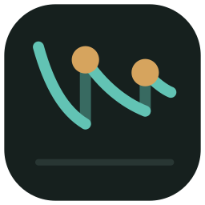

# Kairos

Flashcards with spaced repetition. Each card comes back at the right moment (*kairos*), before you forget it.

## Logo

The mark is the spaced-repetition sawtooth. Memory decays along the forgetting curve. Each bronze dot is a review at the right moment; it lifts recall back up, and the next decay is slower.

## How it works

- `app.html` is the whole app: one HTML page, no build step.
- It runs as a claude.ai artifact and stores data in the artifact database (`claude.use("db")`).
- Claude creates cards from materials sent in the claude.ai Project "Flashcards". The spec is in [`docs/spec.md`](docs/spec.md).
- Scheduling: FSRS-4.5 with default weights, plus Anki-style learning steps (1 min, 10 min; relearning 10 min).
- Cards support simple Markdown and LaTeX (`$…$`, `$$…$$`) through MathJax.

## Offline

Every write goes to a local outbox (`localStorage`) first and syncs when the connection allows. Pending answers stay on screen and survive a closed tab. The page itself needs a connection to open: claude.ai blocks service workers. Test: `npm i jsdom@24 && node tests/offline.test.js`.

## Limits

- Outside claude.ai the page shows a notice and loads no data. Hosting elsewhere (GitHub Pages) needs a new storage layer.
- Review progress is single-user. Share the artifact with others as "Can view" only.
